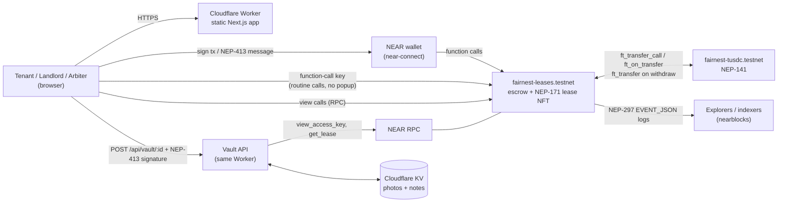
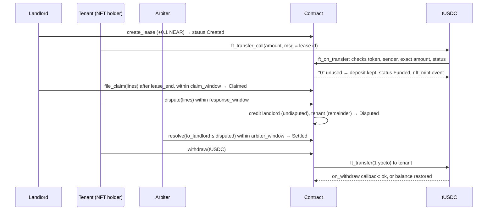

# Architecture

FairNest has three deployable parts and no backend server or database of its own.

| Part | Tech | Where it runs | Holds |
| --- | --- | --- | --- |
| Escrow + lease NFT contract | Rust, near-sdk 5.30 (`contract/`) | NEAR testnet, `fairnest-leases.testnet` | deposits, leases, claims, balances, NFT ownership |
| Web app | Next.js 16 static export, React 19, Motion (`frontend/src`) | Cloudflare Workers static assets | nothing (reads the chain, signs through the wallet) |
| Vault Worker | TypeScript Cloudflare Worker + KV (`frontend/worker/index.ts`) | same Worker, route `/api/vault/*` | private inspection photos and notes (off-chain) |
| tUSDC test token | Rust, near-contract-standards NEP-141 (`test-token/`) | `fairnest-tusdc.testnet` | testnet stablecoin with a public faucet |

## Components

## Contract layout (`contract/src`)

| File | Responsibility |
| --- | --- |
| `lib.rs` | `Lease` model, the state machine, money movement (`credit`, `withdraw`, `on_withdraw`), deadlines, NEP-297 events, views |
| `nft.rs` | NEP-171 core (`nft_transfer`, `nft_transfer_call`, `nft_resolve_transfer`), NEP-177 metadata with an on-chain SVG, NEP-181 enumeration, the hand-over rules |

State (`near_sdk::store`):

| Collection | Key → value | Purpose |
| --- | --- | --- |
| `leases: Vector<Lease>` | lease id (u32 index) → lease | the whole record: parties, token, amount, deadlines, claim lines, disputed indexes, payouts, `history`, `successor` |
| `by_account: LookupMap<AccountId, Vec<u64>>` | account → lease ids | dashboards and `nft_tokens_for_owner` without an indexer |
| `balances: LookupMap<(AccountId, Option<AccountId>), u128>` | (account, token or NEAR) → amount | credited payouts waiting for `withdraw` |

Design choices:

- **The NFT owner is `lease.tenant`.** There is no second ownership map. Payout, claim answers, hand-over, the vault and the wallet view all read the same field, so the token cannot drift from the money ([README: The lease NFT](README.md#the-lease-nft-track-nfts)).
- **Pull payments.** Settlement only writes `balances`. `withdraw` moves the money and restores the balance if the transfer fails.
- **History on-chain.** Each lease keeps its own event list (capped, see [AUDIT.md F-1](AUDIT.md)), so the timeline, holder list and CSV export need no indexer.
- **A flat 0.1 NEAR storage deposit per lease**, with every input bounded (10 lines, 300-byte text, 16 history events).

## Transaction lifecycle: the dispute path (lease 0 on testnet)

If a party goes silent, `finalize` (anyone can call it) takes the place of the missing step. The rules are in the [README state machine](README.md#state-machine).

## Web app (`frontend/src`)

| Route | What it does |
| --- | --- |
| `/` | landing page and live explainer |
| `/app` | dashboard: your leases, balances ready to withdraw, tUSDC faucet |
| `/new` | create a lease |
| `/lease?id=N` | role-aware actions (fund, hand over, claim, accept/dispute, rule, finalize), holder timeline, claim lines, split bar, on-chain record, CSV |
| `/vault?id=N` | private inspection vault (NEP-413 unlock) |
| `/profile?account=` | the account's lease NFTs and clean move-out badges |

- **Wallets.** `@hot-labs/near-connect` handles wallet selection. On sign-in, `function-call-key-plugin` adds a function-call key limited to `fairnest-leases.testnet`, the methods `file_claim, accept, dispute, resolve, finalize, withdraw, cancel, release_full, approve_successor`, and a 0.25 NEAR gas allowance (`frontend/src/providers/near-provider.tsx`). Deposits (`fund_native`, `ft_transfer_call`) and NFT transfers (1 yocto) still go through the wallet.
- **Reads.** All reads are direct RPC view calls. There is no server-side cache.
- **Evidence.** The browser computes a file's sha256 (`lib.ts` `sha256Hex`), and only the hash and a link go on-chain.

## Vault Worker (`frontend/worker/index.ts`)

On every request, `POST /api/vault/:lease/open|add` runs these checks in order. The first failure returns 403.

1. The message is `Open the FairNest vault for lease <id> at <ms>` and names this lease.
2. The recipient is `fairnest-vault`.
3. The timestamp is less than 10 minutes old.
4. The ed25519 signature is valid over the NEP-413 payload (tag 2^31+413, message, 32-byte nonce, recipient).
5. `view_access_key` says the key is a **FullAccess** key of the claimed account.
6. `get_lease` says the account is the current NFT holder, the landlord, or the arbiter while the lease is `Disputed`.

Entries live in KV under `vault:<lease>:<ts>`, with at most 60 entries and images of 1 MB or less. Every check is exercised live in [`tests/api/vault.test.mjs`](tests/api/vault.test.mjs).

## Performance and scale

- **Contract calls are O(1) in the number of leases.** Each method loads one lease record, and records are bounded in size.
- **Views are not paginated before loading.** `get_leases_for`, `nft_tokens_for_owner` and `nft_tokens` load whole lists, so they slow down for accounts with very many leases ([AUDIT.md F-6](AUDIT.md)). Views are free and gas-capped, so this costs speed, not money or safety.
- **Storage.** About 10 KB worst case per lease, paid by the 0.1 NEAR deposit (NEAR charges 1 NEAR per 100 KB).
- **Frontend.** The frontend is static files on Cloudflare's edge. The Worker only runs for `/api/*`.
- **Vault.** Each vault request makes three RPC round-trips (access key, lease, signature verification is local) and one KV list.
