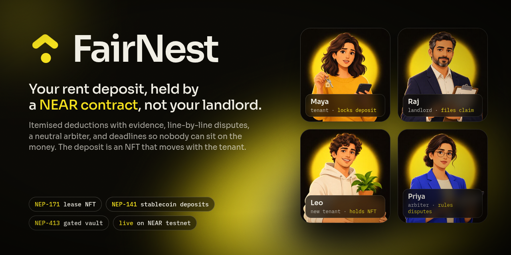
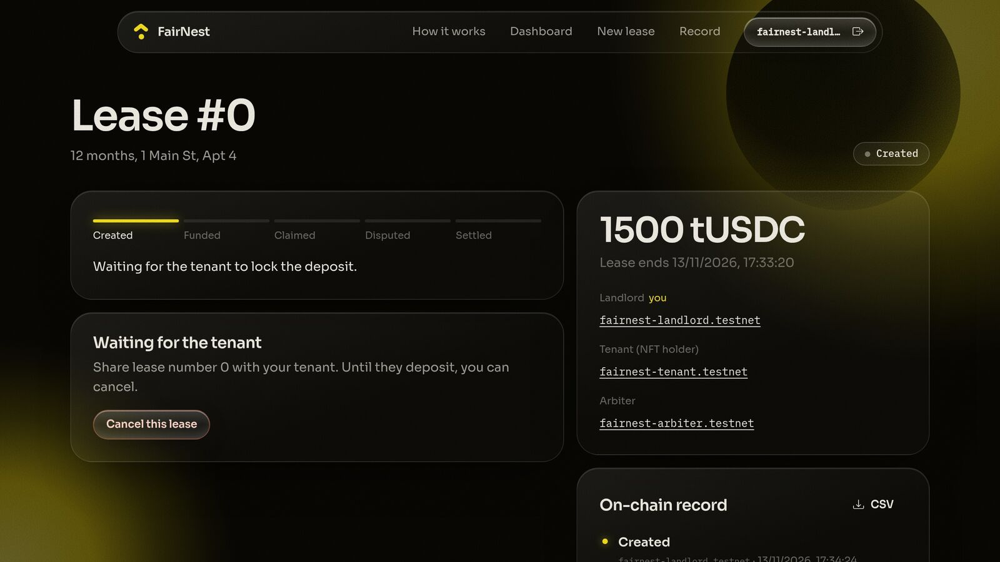
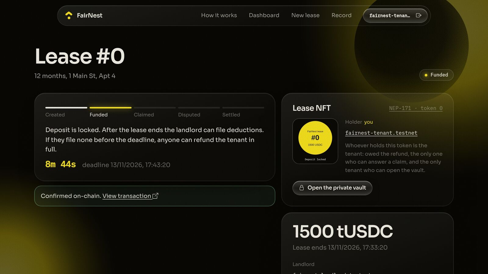
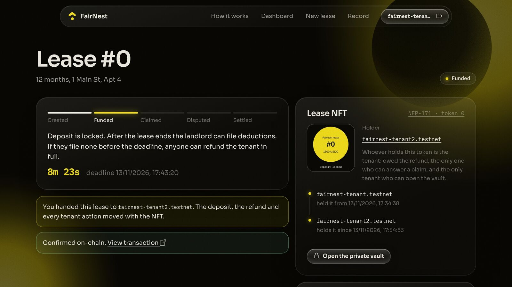
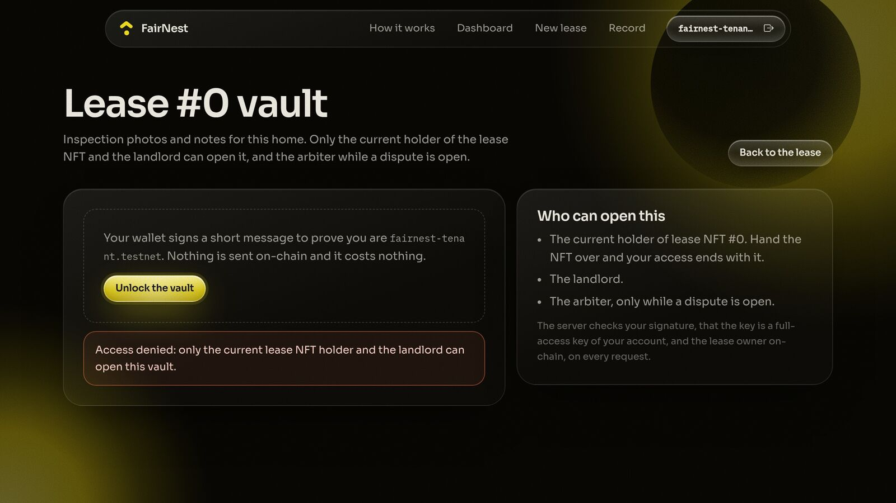
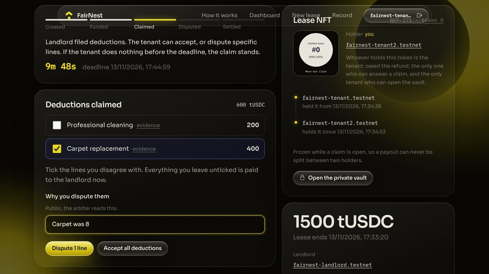
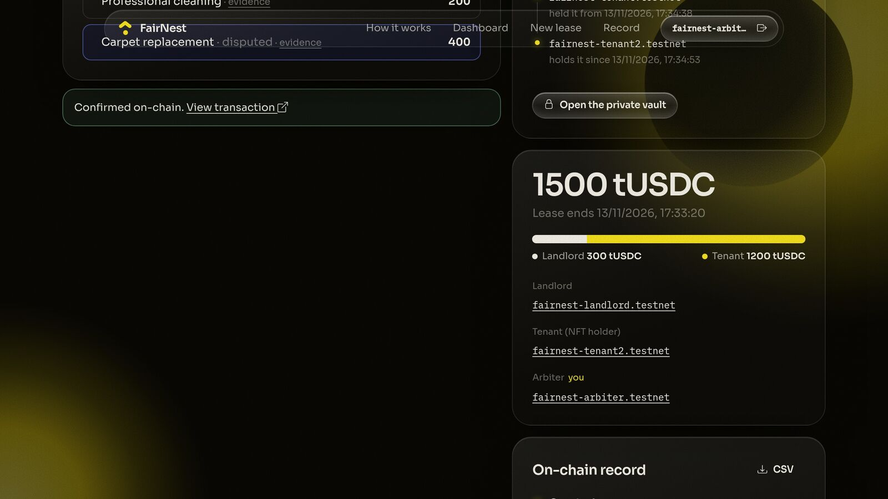
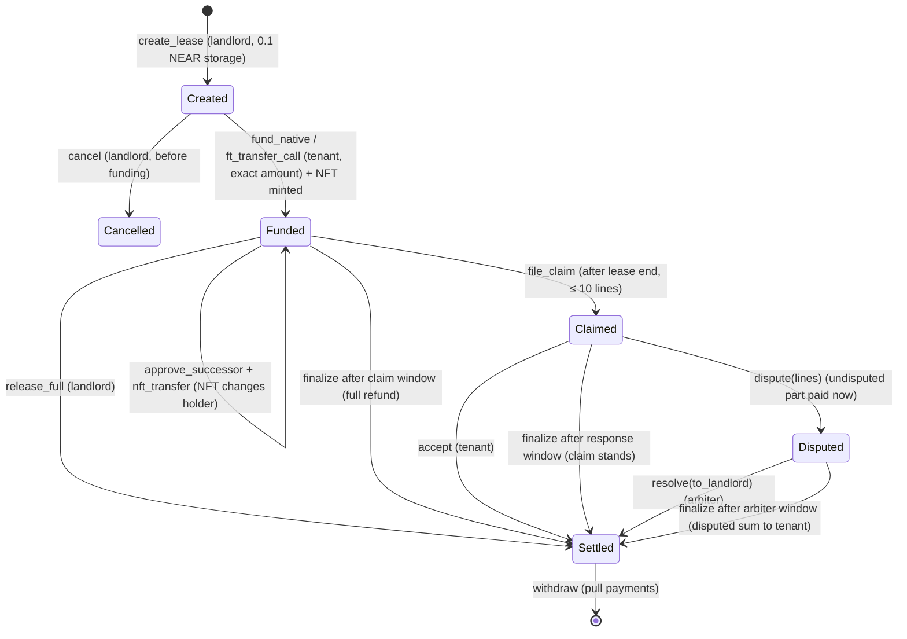

<p align="center">
  
</p>

## About

Rent security-deposit escrow on NEAR. The deposit is held by a smart contract, not the landlord, and is
itself a NEP-171 NFT that moves with the tenant. Deductions are itemised with evidence, the tenant can
dispute them line by line, a neutral arbiter rules, and deadlines mean nobody can sit on the money.

**Tags:** `near` · `nep-171` · `nep-141` · `nep-413` · `nft` · `escrow` · `stablecoin` · `rental` · `security-deposit` · `proptech` · `rust` · `nextjs` · `cloudflare-workers`

<p align="center">
  <a href="https://youtu.be/cMCJI5074Dw"></a>
  <a href="https://fairnest.adoranto737.workers.dev"></a>
  <a href="https://testnet.nearblocks.io/address/fairnest-leases.testnet"></a>
  <a href="tests/results/contract-sandbox-tests.log"></a>
  <a href="tests/results/onchain-verify.log"></a>
  <a href="AUDIT.md"></a>
  <a href="LICENSE"></a>
</p>

<p align="center">
  
</p>

## Demo video

<p align="center">
  <a href="https://youtu.be/cMCJI5074Dw"></a><br>
  <a href="https://youtu.be/cMCJI5074Dw"><b>▶ Watch the demo on YouTube</b></a>. It shows Maya, Raj, Leo and Priya running a real lease on testnet.
</p>

<p align="center">
  <a href="#the-problem">Problem</a> ·
  <a href="#how-it-works-the-story-of-one-deposit">How it works</a> ·
  <a href="#how-fairnest-uses-near">NEAR integration</a> ·
  <a href="#check-it-in-2-minutes">Check it in 2 minutes</a> ·
  <a href="#try-it">Try it</a> ·
  <a href="JUDGES.md">For judges</a> ·
  <a href="AUDIT.md">Audit</a> ·
  <a href="tests/">Tests and proof</a>
</p>

---

The deposit itself is a **NEP-171 NFT**. Whoever holds the token is the tenant: they are owed the refund,
are the only account that can answer a claim, and are the only tenant who can open the lease's private
vault. If the tenant moves out early, the landlord approves a replacement, and the NFT moves to them along
with the deposit and every right attached to it. The old tenant keeps nothing.

Built at NEAR HACKATHON (Nov 2026). Tracks: NFTs That Do Something (`nfts`), Real-World Money (`realworld`), Open Innovation (`open`).
All code was written during the hackathon window.

| | |
| --- | --- |
| Demo video | https://youtu.be/cMCJI5074Dw |
| Live app (testnet) | https://fairnest.adoranto737.workers.dev. The settled demo lease is at [`/lease?id=0`](https://fairnest.adoranto737.workers.dev/lease?id=0), and no wallet is needed to view it. |
| Contract | [`fairnest-leases.testnet`](https://testnet.nearblocks.io/address/fairnest-leases.testnet) (escrow + lease NFT). The deployed code hash equals the wasm built from this repo; see [tests](tests/README.md). |
| One command to verify everything on-chain | `python3 tests/onchain/verify.py` runs 29 checks against testnet using the Python stdlib only. [Last output](tests/results/onchain-verify.log) |
| One command to run every flow locally | `cd contract && cargo test -- --nocapture` runs 6 sandbox flows + 1 unit test. [Last output](tests/results/contract-sandbox-tests.log) |
| Judge guide | [JUDGES.md](JUDGES.md): each claim with the file, test or transaction that proves it |

## The problem

A security deposit is often one to ten months of rent. Today the landlord holds it, decides the deductions
alone, and returns it whenever they like. The tenant's only remedy is a complaint, a deposit scheme where
one exists, or small-claims court. Landlords have the opposite problem: a tenant who leaves damage and then
says "it was like that".

| Where | What the source says |
| --- | --- |
| United States | Among renters who moved from a previous rental, **43%** got their entire deposit back and **22%** got **none** of it back ([Zillow Consumer Housing Trends, Apr 2023](https://www.zillow.com/research/rental-conditions-inspections-neighborhoods-and-plans-to-move/)). |
| England & Wales | **4.7 million** deposits are protected, and the average deposit is **£1,175**. **46,950** cases needed formal adjudication in the 12 months to March 2025 ([NRLA, citing the TDS Statistical Briefing 2024/25, Dec 2025](https://www.nrla.org.uk/news/what-2025-taught-us-about-deposit-disputes)). |
| UK, even with a statutory scheme | **46%** of renters did not know they could challenge unfair deductions, and only **4%** had used the formal dispute process. A quarter of those who did not challenge said the landlord threatened a larger claim or refused to take part in adjudication ([The Guardian on Generation Rent research, Jul 2025](https://www.theguardian.com/society/2025/jul/20/rental-deposit-scheme-puts-millions-in-the-pockets-of-landlords)). |
| Bengaluru, India | Deposits typically run **6 to 10 months' rent** (₹2.4–4 lakh at ₹40,000/month), and tenants report deductions for vague reasons such as "wall stains" and "general wear and tear", with no written terms ([Hindustan Times, Apr 2025](https://www.hindustantimes.com/real-estate/bengaluru-landlords-cite-stains-and-wear-and-tear-as-reasons-to-justify-security-deposit-deductions-101744902652453.html)). |

The common pattern: one side holds the money and decides, there is no itemised record both sides can see,
and the cheapest move for the holder is to wait. FairNest takes the money out of either party's hands and
puts the rules in code:

| Today | With FairNest |
| --- | --- |
| Landlord holds the deposit | A contract holds it. Neither party can move it outside the rules. |
| Deductions are one lump sum, decided alone | Each line has a reason, an amount, an evidence link and the evidence file's sha256 |
| Disputing means disputing everything | The tenant disputes single lines. Undisputed money pays out at once. |
| A silent landlord keeps the money | No claim before the deadline: full refund, applied by anyone |
| A silent tenant blocks the landlord | No answer before the deadline: the claim stands |
| A silent arbiter blocks everyone | No ruling before the deadline: the disputed sum goes back to the tenant |
| Moving out early means refund-and-repay | The tenant hands the lease NFT to an approved replacement. The deposit moves with it. |

## How it works: the story of one deposit

|  |  |  |  |
| :---: | :---: | :---: | :---: |
| **Maya**, tenant<br>`fairnest-tenant.testnet` | **Raj**, landlord<br>`fairnest-landlord.testnet` | **Leo**, replacement tenant<br>`fairnest-tenant2.testnet` | **Priya**, neutral arbiter<br>`fairnest-arbiter.testnet` |

These are the four demo accounts that ran lease 0 on testnet, and the numbers below are that lease's real
numbers. The script for the demo video is in [`video/STORY.md`](video/STORY.md).

```mermaid
sequenceDiagram
    autonumber
    actor Raj as Raj (landlord)
    actor Maya as Maya (tenant)
    actor Leo as Leo (new tenant)
    actor Priya as Priya (arbiter)
    participant C as fairnest-leases.testnet
    participant T as tUSDC (NEP-141)

    Raj->>C: create_lease(tenant=Maya, arbiter=Priya, 1500 tUSDC, deadlines)
    Maya->>T: ft_transfer_call(1500, msg=lease 0)
    T->>C: ft_on_transfer → lease Funded, NFT #0 minted to Maya
    Raj->>C: approve_successor(Leo)
    Maya->>C: nft_transfer(Leo, token 0) + 1 yocto
    Note over C: lease.tenant = Leo. Refund, claim answers and vault access all move to Leo.
    Raj->>C: file_claim([cleaning 200, carpet 400] + evidence sha256)
    Leo->>C: dispute([carpet], "8 years old, normal wear")
    Note over C: cleaning 200 → Raj and remainder 900 → Leo credited now; 400 held
    Priya->>C: resolve(to_landlord = 100)
    Note over C: Settled: Raj 300, Leo 1200
    Leo->>C: withdraw(tUSDC) → 1200
    Raj->>C: withdraw(tUSDC) → 300
```

| | |
| :---: | :---: |
| <br>**1. Raj creates lease #0**: 1500 tUSDC, Maya as tenant, Priya as arbiter | <br>**2. Maya locks the deposit**: lease NFT #0 is minted to her ("Deposit locked") |
| <br>**3. Maya hands the NFT to Leo**: the holder timeline shows both | <br>**4. Maya is now refused by the private vault**: only the current holder gets in |
| <br>**5. Leo disputes only the carpet line**, with a reason | <br>**6. Priya awards 100 of 400**: settled at 300 for Raj and 1200 for Leo |

More screens are in [`docs/assets/screens/`](docs/assets/screens/): the landing page, the replacement
approval, the claim form, the dashboard withdraw, and the rental record page.

### State machine



| Method | Who | What happens |
| --- | --- | --- |
| `create_lease` | landlord | Sets the tenant, arbiter, currency (NEAR or a NEP-141 stablecoin), amount, lease end and three deadlines. 0.1 NEAR storage deposit. |
| `fund_native` / `ft_transfer_call` | tenant | Locks the exact deposit and mints the lease NFT. A wrong token, sender or amount is rejected and refunded. |
| `file_claim` | landlord | After the lease ends: up to 10 deduction lines, each with a reason, amount, evidence link and evidence sha256. The total cannot exceed the deposit. |
| `accept` | NFT holder | The claim is paid, and the rest of the deposit returns to the holder. Only before the response deadline. |
| `dispute(lines)` | NFT holder | Undisputed lines and the unclaimed remainder pay out immediately. Only the disputed lines wait. |
| `resolve(to_landlord)` | arbiter | Splits the disputed sum. Cannot award more than what is disputed. Only before the arbiter deadline. |
| `release_full` | landlord | Returns the whole deposit at any time. |
| `finalize` | anyone | Applies an expired deadline. |
| `withdraw(token)` | anyone with a balance | Moves the account's credited share to its wallet. |
| `approve_successor(account)` | landlord | While `Funded`: names the one replacement tenant the NFT may move to. |
| `nft_transfer` / `nft_transfer_call` | NFT holder | Hands the lease to the approved replacement (1 yoctoNEAR, so the wallet confirms). |
| `nft_token`, `nft_tokens_for_owner`, `nft_metadata`, … | anyone | NEP-171/177/181 views. The token image is an SVG drawn by the contract from the lease's current stage. |

## How FairNest uses NEAR

Every item below is in the code and covered by a test or an on-chain check. [JUDGES.md](JUDGES.md#near-integration) links each one.

| NEAR feature | Used for | Where |
| --- | --- | --- |
| **NEP-171 / 177 / 181** non-fungible tokens | The lease *is* the token. `nft_token(id).owner_id` is `lease.tenant`, the same field the payout and access checks read, so the token cannot drift from the money. | [`contract/src/nft.rs`](contract/src/nft.rs) |
| **Dynamic on-chain NFT media** | The token's SVG is rendered by the contract from the live lease state: "Deposit locked", "Move-out claim", "In dispute", "Closed". | `nft.rs` `token()` |
| **NEP-141 `ft_transfer_call` / `ft_on_transfer`** | The tenant deposits a stablecoin in one transaction. The contract checks the token, sender and amount, and any failure is refunded by the token's resolver. | `lib.rs` `ft_on_transfer` |
| **Promises + private callbacks** | Pull payments: `withdraw` sends NEAR or `ft_transfer`, and `on_withdraw` restores the balance if the transfer fails. Tested with an unregistered receiver. | `lib.rs` `withdraw`, `on_withdraw` |
| **NEP-297 events** | Every state change emits `EVENT_JSON:{"standard":"fairnest",…}` plus the standard `nft_mint` / `nft_transfer` events, so indexers and wallets can follow leases. | `lib.rs` `log_event`, `nft.rs` `emit` |
| **NEP-413 signed messages** | The private inspection vault: each request carries a fresh off-chain signature, and the Worker verifies it and reads the current NFT holder from chain. | [`frontend/worker/index.ts`](frontend/worker/index.ts) |
| **Access keys** | The vault accepts only *full-access* keys (`view_access_key`). The web app signs routine calls with a function-call key limited to this contract, so most steps need no wallet popup. NFT transfers require 1 yocto, which forces a full-access confirmation. | worker + `frontend/src/providers` |
| **Named accounts** | Parties read as `fairnest-landlord.testnet`, not hex. The arbiter is just an account id, so it can be a DAO. | everywhere |
| **Storage staking** | A flat 0.1 NEAR per lease covers its record. Record size is bounded (10 lines, 300-byte text, 16 history events). | `lib.rs` constants, [AUDIT.md F-1](AUDIT.md#f-1-high-unpaid-history-growth-through-approve_successor-fixed) |
| **near-workspaces sandbox** | Every flow, including deadlines, runs against a real local node with fast-forwarded blocks. | [`contract/tests/flows.rs`](contract/tests/flows.rs) |

## The lease NFT (track `nfts`)

Code: `contract/src/nft.rs`. Tests: `lease_nft_moves_the_deposit_and_every_tenant_right` and
`transfer_call_to_a_non_contract_returns_the_token` in `contract/tests/flows.rs`.

**What the NFT owns.** The token id is the lease id. The token is minted to the tenant in the same receipt
that locks the deposit (`nft_mint` event) and is never burned; after settlement it stays as the lease's
receipt. The token owner is not a separate map: `nft_token(id).owner_id` *is* `lease.tenant`. Everything on
the tenant side reads that one field at call time:

| Right | Where it is checked |
| --- | --- |
| Refund / payout | `credit_settlement`, `dispute`, `resolve` and `finalize` credit `lease.tenant` at the moment they run |
| Answer a claim | `accept` and `dispute` require `caller == lease.tenant` |
| Hand the lease on | `nft_transfer` requires `caller == lease.tenant` |
| Open the private vault | the vault Worker reads `get_lease` on every request and allows `lease.tenant` (plus the landlord, and the arbiter during a dispute) |
| Show up in a wallet | `nft_tokens_for_owner` filters on `lease.tenant` |

**How control passes on transfer.** `nft_transfer(receiver_id, token_id)` needs exactly 1 yoctoNEAR, which
means a full-access key, so the wallet asks the holder to confirm. It succeeds only if all of these hold:
- the caller is the current holder;
- the lease is `Funded` (deposit locked, no claim filed);
- the receiver is the replacement the landlord approved with `approve_successor`.

In that one receipt the contract sets `lease.tenant = receiver`, clears the approval, and logs both a
`transferred` history event and a standard `nft_transfer` event. From the next block on, every check in the
table above sees the new holder.

**Threat model: every way the seller (the old tenant) could try to keep the money or access.**

| Attack | Why it fails |
| --- | --- |
| Keep calling `accept`/`dispute` after selling | Both check `lease.tenant` live, so the old tenant gets `only tenant`. Tested. |
| Sell during a payout so part goes to each | Transfer is only allowed in `Funded`. Once a claim is filed the token is frozen until settlement, so no payout is ever split. Tested ("mid-payout"). |
| Keep a balance credited before the sale | Nothing is credited while `Funded`, the only state a sale can happen in. |
| Pull the token back later | Only the current holder can transfer, and only to a landlord-approved account. The approval is single-use and cleared on transfer. Tested. |
| Leave an approval or operator behind | NEP-178 approvals are not implemented (`approval_id` must be empty), so no operator can move the token for the old owner. |
| `nft_transfer_call` to a contract that grabs and returns it | `nft_resolve_transfer` only returns the token if the receiver still holds it **and** the lease is still `Funded`. Tested with a receiver that has no contract: the token comes back. |
| Use the vault with an old browser session | There is no session. Each request carries a fresh NEP-413 signature (valid 10 minutes), and the holder is read from chain every time. Verified live: after the transfer the old tenant gets 403. |
| Sign the vault request with a limited function-call key | Rejected: only full-access keys count. |
| Sell to a stranger the landlord never vetted | The receiver must be the approved successor, the same rule as a real lease assignment. |
| Transfer before funding to dodge the deposit | No token exists until the exact deposit is locked. |

Not covered by code: payment between the old and new tenant for the deposit they take over. Today that is
agreed off-chain; the next step is an `nft_transfer_call` into a sale contract that pays the old tenant first.

**Gated page.** `/vault?id=N` holds move-in and move-out inspection photos and notes off-chain in
Cloudflare KV, since anything on-chain is public. **History per NFT.** The lease page shows the token's live
image, every holder with dates, what was paid in, every claim line and both payouts. `/profile?account=`
shows the lease NFTs an account holds, plus a **clean move-out** badge for each lease it held at settlement
with the full deposit returned. The badge is derived from on-chain history, so it cannot be bought or
transferred.

### Safety choices

- **Pull payments.** Settlement only credits balances, and `withdraw` sends the tokens. If a transfer fails, a callback restores the balance.
- `ft_on_transfer` checks the calling token contract against the lease's token, and any failure refunds the tenant.
- Input sizes are capped (10 lines, 300 bytes per text field, 16 history events) so the flat storage deposit covers the record.
- Every deadline window is capped at 365 days and the lease end at 10 years, so no lease can stall forever or overflow its deadline arithmetic.
- `accept`, `dispute` and `resolve` are refused once their deadline has passed, so exactly one outcome is possible at any moment.
- Internal security review with 10 findings, 3 fixed and redeployed: [AUDIT.md](AUDIT.md).

**Trust note (testnet).** The contract has no admin method, but the contract account still has a
full-access key, which was used to deploy the audit fixes. Until that key is deleted, "nobody can move a
deposit" depends on trusting the key holder not to redeploy. Before mainnet, deploy, verify the code hash,
then delete the key ([AUDIT.md F-9](AUDIT.md#f-9-info-centralisation-acknowledged)).

## Check it in 2 minutes

No install beyond `curl` / Python 3:

1. Run `python3 tests/onchain/verify.py`. You should see `ALL CHECKS PASSED` (29 checks): lease 0 is `Settled` with 300 / 1200, the NFT is owned by `fairnest-tenant2.testnet`, all 9 demo transactions succeeded, the site is up, and the vault refuses an unsigned request.
2. Or call the RPC by hand:

```sh
curl -s https://rpc.testnet.near.org -H 'Content-Type: application/json' -d '{"jsonrpc":"2.0","id":1,"method":"query","params":{"request_type":"call_function","finality":"final","account_id":"fairnest-leases.testnet","method_name":"get_lease","args_base64":"eyJsZWFzZV9pZCI6IjAifQ=="}}' | python3 -c 'import sys,json;print(bytes(json.load(sys.stdin)["result"]["result"]).decode())'
```

   You should see `"status":"Settled"`, `"tenant":"fairnest-tenant2.testnet"`, `"to_landlord":"300000000"` and `"to_tenant":"1200000000"` (300 and 1200 tUSDC), and a `transferred` event in `history`. For the NFT, replace `get_lease` with `nft_token` and the args with `eyJ0b2tlbl9pZCI6IjAifQ==` (`{"token_id":"0"}`) to see `"owner_id":"fairnest-tenant2.testnet"` and the SVG image.
3. Open https://fairnest.adoranto737.workers.dev/lease?id=0. You should see the same lease with its holder timeline, claim lines, the 300 / 1200 split bar and the on-chain record.

## Live testnet deployment

| What | Account |
| --- | --- |
| Escrow + lease NFT contract | [`fairnest-leases.testnet`](https://testnet.nearblocks.io/address/fairnest-leases.testnet) |
| tUSDC test token (public `mint`) | [`fairnest-tusdc.testnet`](https://testnet.nearblocks.io/address/fairnest-tusdc.testnet) |
| Demo landlord / tenant / replacement tenant / arbiter | `fairnest-landlord.testnet`, `fairnest-tenant.testnet`, `fairnest-tenant2.testnet`, `fairnest-arbiter.testnet` |

`fairnest-escrow.testnet` runs the earlier version without the NFT; its lease 0 is a finished dispute too.
The audit fixes were deployed to `fairnest-leases.testnet` on 2026-11-14 in
[`8kRsYp4A…`](https://testnet.nearblocks.io/txns/8kRsYp4AUcnV7reboLz3FUhF29PG4zcbWJenbWbTgP7d). The storage
layout is unchanged, so lease 0 below is still readable.

Lease `0` was run by `scripts/demo.sh`:

| Step | Transaction |
| --- | --- |
| Landlord creates a 1500 tUSDC lease | [6VQemHAy...](https://testnet.nearblocks.io/txns/6VQemHAyAXGPvcjUxLjtpb5AH98uaqn3t1cTDQtW5wBS) |
| Tenant locks the deposit, lease NFT minted | [A6iguWyA...](https://testnet.nearblocks.io/txns/A6iguWyAXeFebXhnSZ6Gz5NQLdQUZ1Kdt5XqUKFEapd8) |
| Landlord approves a replacement tenant | [GJdf6DsZ...](https://testnet.nearblocks.io/txns/GJdf6DsZHdbbAiwn7aVFKR6JFyMLQSxk79HfZqhH5zRs) |
| Tenant hands the lease NFT over (`nft_transfer`) | [C6U749WD...](https://testnet.nearblocks.io/txns/C6U749WD8ghsMqsVJSf2A4hFANCiCXiu3M76QK8qqYwB) |
| Landlord claims 200 cleaning + 400 carpet | [7whGQPhF...](https://testnet.nearblocks.io/txns/7whGQPhFCAyRd9Q1TFzAGwvW7RbHhswVq79EaJAXhi77) |
| Replacement tenant disputes the carpet line | [FUdqxMTE...](https://testnet.nearblocks.io/txns/FUdqxMTEpmHFUk6zvsNyGiNWVD2QQRUtfgfXBdkyuE1Q) |
| Arbiter awards 100 of the 400 to the landlord | [6R1YjfpT...](https://testnet.nearblocks.io/txns/6R1YjfpTe1YaB13kCtrtJi2aspaqnHKmK2gia2gGW5Za) |
| Replacement tenant withdraws 1200 tUSDC | [Ce7GGLH1...](https://testnet.nearblocks.io/txns/Ce7GGLH15pFVwG1p1gszziDyX4agyktjvXvUYW7gGX5u) |
| Landlord withdraws 300 tUSDC | [HPxB6rfb...](https://testnet.nearblocks.io/txns/HPxB6rfbtj9d3cTk8y1ACx5TzH8aM7gemGD2Bw6E89YR) |

## Try it

### Path A: local sandbox, no account or funds needed (about 5 minutes, mostly compile time)

Prerequisites: Rust (the repo pins 1.97.1 in `rust-toolchain.toml`) and `cargo-near`. The quickest install is
the official prebuilt binary:
`curl --proto '=https' --tlsv1.2 -LsSf https://github.com/near/cargo-near/releases/latest/download/cargo-near-installer.sh | sh`.
The fallback is `cargo install cargo-near --locked` (about 15 minutes; on GCC 16 systems prefix it with
`CC=clang CXX=clang++`). The first run downloads a local NEAR sandbox node.

1. Run `cd contract && cargo test -- --nocapture`.
2. You should see six sandbox tests pass, plus one unit test. Each prints the steps it runs:
   - `happy_path_native_near`: a 5 NEAR deposit and a 1.5 NEAR claim accepted. The tenant withdraws 3.5 NEAR.
   - `partial_dispute_with_token_and_arbiter`: a 1000 tUSDC deposit and a 100 + 300 claim. The tenant disputes the 300, so 100 and 600 pay out at once, and the arbiter awards 100 of the 300. The landlord's first withdraw fails because they are not registered on the token, and the balance is restored.
   - `timeouts_protect_both_sides`: each of the three deadlines settles the lease as listed above. A late dispute, accept or ruling is rejected.
   - `lease_nft_moves_the_deposit_and_every_tenant_right`: funding mints the NFT.
     - These transfers fail: without approval, by a non-holder, to an unapproved account, or without 1 yocto.
     - The approved hand-over works.
     - The old tenant can no longer accept, dispute, pull the token back or withdraw.
     - A transfer during the dispute (mid-payout) is rejected.
   - `transfer_call_to_a_non_contract_returns_the_token`: `nft_transfer_call` to an account with no receiver returns the token.
   - `guards_reject_bad_input`: these are all rejected: wrong funder, wrong amount, wrong token (refunded), an early claim, a claim above the deposit, windows over 365 days, history beyond 16 events, and aliased ids.

### Path B: testnet from the command line

Prerequisites: Path A plus the `near` CLI:
`curl --proto '=https' --tlsv1.2 -LsSf https://github.com/near/near-cli-rs/releases/latest/download/near-cli-rs-installer.sh | sh`.

1. Run `PREFIX=<unique-name> ./scripts/deploy.sh`. It creates six faucet-funded testnet accounts and deploys both contracts.
2. Run `PREFIX=<unique-name> ./scripts/demo.sh`. It runs the full flow: a 1500 tUSDC deposit, a hand-over to `-tenant2`, a 200 + 400 claim, a disputed carpet line and an arbiter award of 100.
3. You should see `"owner_id": "<prefix>-tenant2.testnet"` after the hand-over, then `"status": "Settled"` with 300 / 1200 and both token balances.

### Path C: the web app

Hosted at https://fairnest.adoranto737.workers.dev; skip to step 4. To run it locally:

1. Run `cd frontend && npm install`.
2. Optionally run `cp .env.example .env.local`. The defaults point at the testnet deployment above.
3. Run `npm run dev` and open http://localhost:3000. The vault needs the Worker, so for the vault use `npm run build && npx wrangler dev`.
4. Use three testnet wallets (any wallet in the connector, switched to testnet). A fourth wallet is needed for the NFT hand-over.
   1. As the **landlord**, click "Create a lease", enter the tenant and arbiter, and keep the 2-minute defaults. You should see status `Created`.
   2. As the **tenant**, click "Get 1,000 tUSDC" on the Dashboard twice, open the lease and click "Deposit". You should see `Funded` and the lease NFT card.
   3. Optionally, as the **landlord**, approve a replacement in the "Lease NFT" panel. Then, as the **tenant**, click "Hand over the lease". You should see the holder change.
   4. As the **landlord**, after the lease end, add deduction lines and click "File N deductions". You should see `Claimed` and a countdown.
   5. As the **tenant / holder**, tick one line, write a reason and click "Dispute 1 line". You should see `Disputed` and the undisputed part paid.
   6. As the **arbiter**, enter the landlord's share and click "Submit ruling". You should see `Settled`.
   7. As each party, click "Withdraw tUSDC" on the Dashboard. You should see a link to the transaction.
   8. Vault: click "Open the private vault", then "Unlock the vault" (your wallet signs a free message). As the old tenant after a hand-over, you should see "Access denied".
   9. Click "Record" in the menu. You should see the lease NFTs held and any clean move-out badges.
5. Click "CSV for your records" on any lease. You should get a download of the timeline, the claim lines and the split.

## Failure cases

- **The arbiter disappears.** The arbiter deadline returns the disputed sum to the tenant, and undisputed money was already paid. A DAO as arbiter removes the single key.
- **A hostile landlord claims the whole deposit.** The tenant disputes every line. Nothing moves until the arbiter rules, and a silent arbiter favours the tenant.
- **A hostile or absent tenant.** If they never respond, the claim stands after the response window. If they never fund, the landlord cancels.
- **The landlord forgets to claim.** Anyone applies the claim deadline, and the tenant gets a full refund.
- **The landlord and arbiter collude.** This is not solved by code. Pick an arbiter both sides trust; the arbiter can never award more than the disputed lines.
- **The wrong token is sent.** `ft_on_transfer` rejects it and the token contract refunds it.
- **The receiver is not registered on the token.** `withdraw` fails safely and the balance stays claimable.

## Repository layout

```
contract/          escrow + lease NFT (near-sdk-rs; src/nft.rs = NEP-171/177/181), tests/flows.rs = sandbox flows
test-token/        tUSDC, NEP-141 with a public faucet mint (testnet only)
frontend/          Next.js 16 static app (@hot-labs/near-connect, near-api-js, Motion)
frontend/worker/   Cloudflare Worker: serves the app and the NEP-413-gated vault API (KV)
scripts/           deploy.sh and demo.sh for testnet (near-cli-rs)
tests/             verify.py (live on-chain checks) and saved results of every check
video/             demo video story, character portraits and the Remotion film project
docs/assets/       logo, banner, screenshots of the live app
AUDIT.md           internal security review; JUDGES.md: claim-to-proof map
```

## Built with

near-sdk-rs and near-contract-standards 5.30, near-workspaces 0.24, cargo-near, near-cli-rs, Next.js 16
from `create-near-app`, `@hot-labs/near-connect`, `near-api-js` 7, `function-call-key-plugin`, Motion,
Cloudflare Workers + KV, Remotion (demo film). Landing-page photos are from Unsplash, credited in place.
The character portraits are AI-generated for the demo video. Code was written with help from an AI coding
assistant.

## Not built (yet)

- A lease as its own sub-account (`lease-42.fairnest.testnet`) that holds the deposit and is controlled by the NFT holder, as in the Top Level Accounts design.
- Paying the outgoing tenant for the deposit they hand over, through `nft_transfer_call` into a sale contract.
- A Sputnik DAO as arbiter (today the arbiter is any account id, so a DAO works in principle, but this is not demonstrated).
- Private AI comparison of move-in and move-out vault photos on NEAR AI Cloud (TEE).
- Gasless tenants through a meta-transaction relayer.
- Interest on held deposits, which some jurisdictions require.
- Cross-chain deposits through NEAR Intents (there is no testnet).
- Mainnet hardening from [AUDIT.md](AUDIT.md): minimum windows, 1-yocto on irreversible calls, a token allowlist, and deleting the contract key.

## License

MIT, see [`LICENSE`](LICENSE).
